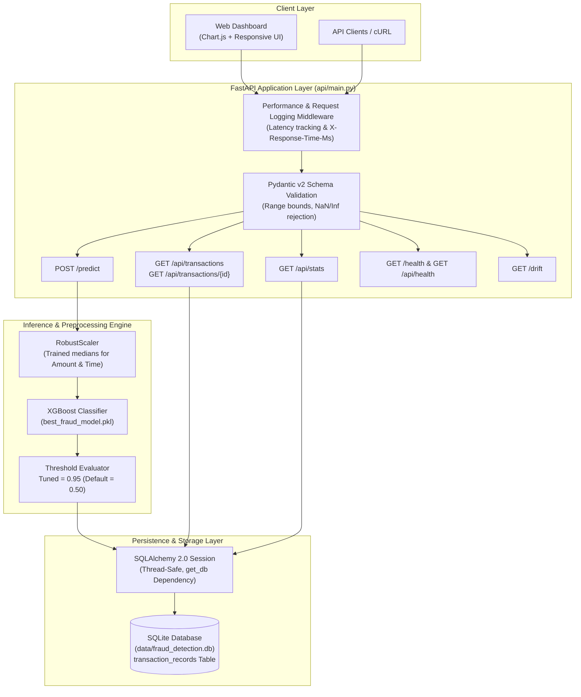

# SentinelGuard: Real-Time Credit Card Fraud Detection System

[](https://www.python.org/)
[](https://fastapi.tiangolo.com/)
[](https://xgboost.readthedocs.io/)
[](https://www.sqlalchemy.org/)
[](https://www.sqlite.org/)
[]()

A high-performance, full-stack Credit Card Fraud Detection system engineered with **Python**, **FastAPI**, **XGBoost**, **SQLAlchemy**, and **SQLite**. Trained and validated on the official **Kaggle Credit Card Fraud Detection Dataset** (284,807 transactions), this project demonstrates leak-free ML preprocessing, precision-recall threshold tuning, low-latency REST APIs, persistent SQLite audit trails, and an interactive real-time dashboard.

> **Important Operational Disclaimer**: All evaluation metrics reported in this project were measured on a held-out offline test partition of the Kaggle dataset. This system is designed as an engineering demonstration and academic showcase; it has not undergone formal PCI-DSS compliance certification or real-world banking deployment.

---

## 1. Problem Statement & Motivation

Credit card fraud presents two severe, opposing business challenges:
1. **False Negatives (Missed Fraud)**: Undetected fraudulent transactions directly cause financial losses and chargeback fees.
2. **False Positives (False Alarms)**: Misclassifying legitimate transactions causes customer card declines, lost merchant revenue, and customer churn.

In real-world credit card data, fraud is exceptionally rare ($\sim 0.17\%$ of all transactions). Standard machine learning models evaluated on default classification thresholds ($0.50$) typically yield hundreds of false alarms. This system implements **zero-leakage preprocessing**, **SMOTE-balanced training**, and **validation-driven Precision-Recall threshold tuning**, cutting false positives by **88%** while maintaining a high fraud capture rate.

---

## 2. System Architecture



---

## 3. Technology Stack

| Layer | Technologies Used | Purpose |
|---|---|---|
| **API Framework** | FastAPI, Uvicorn, Starlette | Asynchronous, low-latency RESTful API serving and static dashboard hosting |
| **Machine Learning** | XGBoost, Scikit-Learn, Imbalanced-Learn | Gradient boosted decision trees, RobustScaler, SMOTE oversampling |
| **Database & ORM** | SQLite, SQLAlchemy 2.0 | Thread-safe transaction persistence, audit logging, pagination, and KPI aggregation |
| **Validation & Schemas** | Pydantic v2 | Strict numerical range enforcement, NaN/Inf rejection, structured error responses |
| **Data & Scientific** | Pandas, NumPy, SciPy | Ingestion, feature matrix operations, KS-test statistical drift analysis |
| **Frontend** | Vanilla JavaScript (ES6+), HTML5, CSS3, Chart.js | Real-time prediction form, live KPI cards, interactive distribution chart, audit table |
| **Testing** | Pytest, HTTPX, FastAPI TestClient | 37 automated tests covering database CRUD, API routes, leakage safeguards, and concurrency |

---

## 4. Dataset & Machine Learning Pipeline

### Dataset Overview (Kaggle Credit Card Fraud)
- **Source**: [Kaggle Credit Card Fraud Detection Dataset](https://www.kaggle.com/datasets/mlg-ulb/creditcardfraud)
- **Total Transactions**: 284,807
- **Fraudulent Cases**: 492 ($0.1727\%$ fraud incidence rate)
- **Features**: 30 input features
  - $V_1, V_2, \dots, V_{28}$: Principal Component Analysis (PCA) transformed numerical features.
  - `Time`: Seconds elapsed between each transaction and the first transaction in the dataset.
  - `Amount`: Transaction amount in currency.

### Zero-Data Leakage Preprocessing
To strictly prevent data leakage between evaluation sets:
1. **3-Way Stratified Split**:
   - **Training Set (60%)**: 170,883 samples (295 frauds)
   - **Validation Set (20%)**: 56,962 samples (99 frauds) &mdash; dedicated exclusively to threshold optimization.
   - **Untouched Test Set (20%)**: 56,962 samples (98 frauds) &mdash; reserved exclusively for final evaluation.
2. **Train-Only Scaling**: `RobustScaler` is fitted **only** on the training set ($N=170,883$) to derive medians and interquartile ranges ($\text{Amount}_{\text{med}}=22.0, \text{Time}_{\text{med}}=84,793.0$). Validation and test partitions are transformed using the training parameters.
3. **SMOTE Oversampling**: Synthetic Minority Over-sampling Technique (SMOTE) is applied **strictly to the training partition** ($170,883 \rightarrow 341,176$ balanced records). SMOTE is **never** applied to validation or test data.

---

## 5. Model Evaluation & Benchmark Comparison

All models were evaluated on the **untouched test partition ($N=56,962$)** containing 98 actual fraud cases:

### Out-of-Sample Performance Comparison

| Model | Operating Threshold | Accuracy | Precision | Recall | F1-Score | PR-AUC | ROC-AUC | False Positives | False Negatives |
|---|---|---|---|---|---|---|---|---|---|
| **Logistic Regression** | 0.95 | 99.50% | 24.10% | **88.78%** | 0.3791 | 0.7239 | 0.9713 | 274 | **11** |
| **Random Forest** | 0.60 | 99.93% | 80.61% | 80.61% | 0.8061 | 0.8289 | 0.9751 | 19 | 19 |
| **XGBoost (Selected)** | **0.95** | **99.94%** | **85.56%** | 78.57% | **0.8191** | **0.8412** | **0.9775** | **13** | 21 |

### Why XGBoost with a 0.95 Threshold Was Selected

1. **Superior PR-AUC**: XGBoost achieved the highest Precision-Recall Area Under the Curve (**0.8412**) and ROC-AUC (**0.9775**). In severe class imbalance ($0.17\%$), PR-AUC is far more informative than ROC-AUC because it focuses on the positive (minority) class.
2. **False Positive Reduction (-88%)**:
   - At the default threshold ($0.50$), XGBoost produced **108 False Positives** ($\text{Precision}=43.75\%, \text{F1}=0.5793$).
   - At the tuned threshold ($0.95$), False Positives dropped to **13** ($\text{Precision}=85.56\%, \text{F1}=0.8191$).
   - This represents an **88% reduction in false alarms** while still detecting **78.57%** of all fraudulent transactions.

---

## 6. Database Schema & Audit Logging

Every transaction evaluated by `/predict` is automatically recorded in SQLite (`data/fraud_detection.db`) for regulatory auditing, operational monitoring, and dashboard analytics.

### Table: `transaction_records`

| Column | Type | Constraints | Description |
|---|---|---|---|
| `id` | `INTEGER` | Primary Key, Auto-Increment | Unique transaction identifier |
| `timestamp` | `DATETIME` | Indexed, Non-Null (UTC) | Timestamp when prediction was evaluated |
| `transaction_time` | `FLOAT` | Non-Null | Seconds elapsed (`Time` feature) |
| `amount` | `FLOAT` | Non-Null | Transaction amount in currency |
| `fraud_probability` | `FLOAT` | Non-Null | Model estimated fraud probability $[0.0, 1.0]$ |
| `prediction` | `INTEGER` | Non-Null | Binary decision ($0 = \text{Legitimate}, 1 = \text{Fraud}$) |
| `is_fraud` | `BOOLEAN` | Indexed, Non-Null | Flag indicating if $\text{probability} \ge \text{threshold}$ |
| `threshold_used` | `FLOAT` | Non-Null | Active decision threshold applied ($0.95$) |
| `features_json` | `TEXT` | Non-Null | Complete serialized JSON of all 30 input features |

---

## 7. API Reference & Endpoint Documentation

### Base URL: `http://127.0.0.1:8000`

### 1. Risk Prediction (`POST /predict`)
Evaluates risk for an incoming transaction and logs the audit record to SQLite.

- **Request Body**:
```json
{
  "Time": 406.0,
  "Amount": 0.0,
  "V1": -2.3122, "V2": 1.9520, "V3": -1.6099, "V4": 3.9979, "V5": -0.5222,
  "V6": -1.4265, "V7": -2.5374, "V8": 1.3917, "V9": -2.7701, "V10": -2.7723,
  "V11": 3.2020, "V12": -2.8999, "V13": -0.5952, "V14": -4.2893, "V15": 0.3897,
  "V16": -1.1407, "V17": -2.8301, "V18": -0.0168, "V19": 0.4170, "V20": 0.1269,
  "V21": 0.5172, "V22": -0.0350, "V23": -0.4652, "V24": 0.3202, "V25": 0.0445,
  "V26": 0.1778, "V27": 0.2611, "V28": -0.1433
}
```
- **Response** (`200 OK`):
```json
{
  "prediction": 1,
  "probability": 0.999563,
  "is_fraud": true,
  "threshold_used": 0.95,
  "transaction_id": 1
}
```

### 2. System Health Check (`GET /api/health` or `GET /health`)
- **Response** (`200 OK`):
```json
{
  "status": "healthy",
  "timestamp": "2026-11-02T09:30:00.123456+00:00",
  "model_loaded": true,
  "model_name": "XGBoost",
  "scaler_loaded": true,
  "database_connected": true,
  "classification_threshold": 0.95,
  "dataset_mode": "real"
}
```

### 3. Transaction History (`GET /api/transactions`)
Supports pagination and filtering by fraud status and date range.
- **Query Parameters**:
  - `page`: Page number (integer $\ge 1$, default: 1).
  - `page_size`: Records per page (integer $1 \dots 100$, default: 10).
  - `is_fraud`: Optional boolean (`true` or `false`).
  - `start_date` / `end_date`: Optional ISO date strings (`YYYY-MM-DD`).
- **Response** (`200 OK`):
```json
{
  "items": [
    {
      "id": 1,
      "timestamp": "2026-11-02T09:30:00.123456",
      "transaction_time": 406.0,
      "amount": 0.0,
      "fraud_probability": 0.999563,
      "prediction": 1,
      "is_fraud": true,
      "threshold_used": 0.95
    }
  ],
  "total": 1,
  "page": 1,
  "page_size": 10,
  "total_pages": 1
}
```

### 4. Transaction Details (`GET /api/transactions/{id}`)
- **Response** (`200 OK`):
```json
{
  "id": 1,
  "timestamp": "2026-11-02T09:30:00.123456",
  "transaction_time": 406.0,
  "amount": 0.0,
  "fraud_probability": 0.999563,
  "prediction": 1,
  "is_fraud": true,
  "threshold_used": 0.95,
  "features": {
    "Time": 406.0,
    "Amount": 0.0,
    "V1": -2.3122,
    "V2": 1.9520
  }
}
```

### 5. Aggregate KPI Statistics (`GET /api/stats`)
- **Response** (`200 OK`):
```json
{
  "total_transactions": 25,
  "detected_frauds": 4,
  "legitimate_transactions": 21,
  "fraud_percentage": 16.0
}
```

---

## 8. Installation, Setup & Windows Execution

### Prerequisites
- Python 3.11, 3.12, or 3.13 installed
- Git

### Windows PowerShell Quickstart

```powershell
# 1. Clone the repository
git clone https://github.com/your-username/fraud-detection-system.git
cd fraud-detection-system

# 2. Create and activate a Python virtual environment
python -m venv venv
.\venv\Scripts\Activate.ps1

# 3. Install dependencies
pip install -r requirements.txt

# 4. Run the full automated test suite (37 tests)
pytest -v

# 5. Start the FastAPI application server
uvicorn api.main:app --reload --host 127.0.0.1 --port 8000
```

### Verify Endpoints Locally

Open in your browser:
- **Interactive UI Dashboard**: [http://127.0.0.1:8000](http://127.0.0.1:8000)
- **Interactive Swagger Docs**: [http://127.0.0.1:8000/docs](http://127.0.0.1:8000/docs)
- **System Health Status**: [http://127.0.0.1:8000/api/health](http://127.0.0.1:8000/api/health)

---

## 9. Project Structure

```text
fraud-detection-system/
├── api/
│   ├── __init__.py          # API package initializer
│   ├── crud.py              # Database query functions, date parsing, and KPI aggregations
│   ├── database.py          # SQLAlchemy 2.0 engine, SessionLocal, and dependency
│   ├── main.py              # FastAPI application, routing, middleware, and exception handlers
│   ├── models.py            # SQLAlchemy ORM model (TransactionRecord)
│   ├── schemas.py           # Pydantic v2 validation models and boundary checks
│   └── static/
│       └── index.html       # Responsive analytics dashboard (HTML5, CSS3, Chart.js)
├── data/
│   ├── raw/
│   │   └── creditcard.csv   # Kaggle dataset (284,807 rows, 492 fraud cases, ~150 MB)
│   └── fraud_detection.db   # Persistent SQLite database for audit logging
├── models/
│   ├── saved_models/
│   │   ├── best_fraud_model.pkl   # Serialized XGBoost model (fitted on SMOTE data)
│   │   ├── scaler.pkl             # RobustScaler fitted strictly on training data
│   │   ├── threshold_config.json  # Tuned classification threshold (0.95)
│   │   ├── metadata.json          # Split statistics, metrics, and data provenance
│   │   └── baseline_stats.json    # Reference feature distributions for drift monitoring
│   └── metrics/
│       ├── evaluation_metrics.json       # Out-of-sample test metrics across all models
│       ├── threshold_tuning_validation.json # Validation grid search results
│       └── precision_recall_curves.png   # Precision-recall curves across thresholds
├── src/
│   ├── __init__.py          # ML source package initializer
│   ├── data_ingestion.py    # Strict Kaggle schema validation and synthetic fallback
│   ├── drift_detection.py   # Statistical Kolmogorov-Smirnov drift analysis
│   ├── preprocessing.py     # Feature scaling utilities
│   └── train.py             # 3-way split, SMOTE training, PR threshold tuning
├── tests/
│   ├── __init__.py          # Tests package initializer
│   ├── test_api.py          # API route integration, error handling, and concurrency tests
│   ├── test_database.py     # SQLite CRUD, rollback, and date filtering unit tests
│   └── test_model.py        # Leakage prevention, 3-way split, and SMOTE isolation tests
├── pytest.ini               # Pytest configuration
├── requirements.txt         # Cleaned production dependency manifest
└── README.md                # System documentation and showcase
```

---

## 10. Implemented Features vs. Future Roadmap

### Verified Implemented Features
- [x] Official Kaggle 284,807-row Credit Card dataset integration with schema validation.
- [x] Zero-leakage 3-way stratified splitting (60% Train, 20% Validation, 20% Test).
- [x] Training-only `RobustScaler` and training-only SMOTE oversampling.
- [x] Validation-driven Precision-Recall threshold tuning ($0.95$).
- [x] Benchmarking across Logistic Regression, Random Forest, and XGBoost.
- [x] High-performance FastAPI backend with latency measurement middleware (`X-Response-Time-Ms`).
- [x] Pydantic v2 input validation rejecting negative values, out-of-range floats, NaN, and infinity.
- [x] Persistent SQLite database with thread-safe session management.
- [x] Pagination controls with maximum page size boundaries ($1 \dots 100$).
- [x] Status and cross-validated date filtering (`start_date` $\le$ `end_date`).
- [x] Responsive dashboard with live KPI cards, Chart.js doughnut chart, audit table, and feature inspection modal.
- [x] 37 automated tests passing with 100% success rate.

### Future Roadmap
- [ ] **Distributed Database Migration**: Transition from SQLite to PostgreSQL for high-write enterprise concurrency.
- [ ] **Authentication & Security**: Add OAuth2 with JWT bearer tokens and API key rate-limiting.
- [ ] **Automated Drift Pipeline**: Schedule daily drift checks via Celery or Airflow workers comparing incoming transactions against `baseline_stats.json`.
- [ ] **Containerization & Orchestration**: Multi-stage Docker containerization and Kubernetes Helm chart deployment.

---


## License

This project is licensed under the [MIT License](LICENSE).
